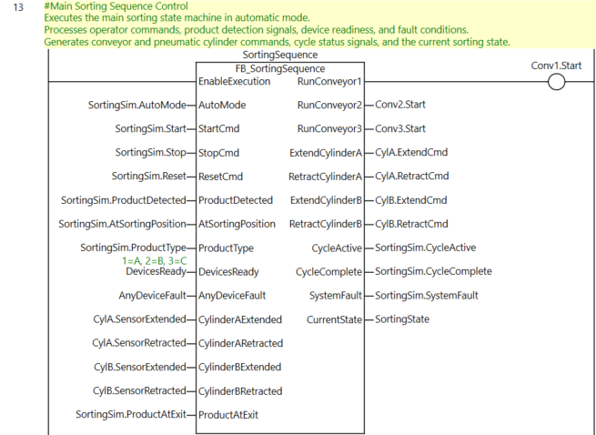
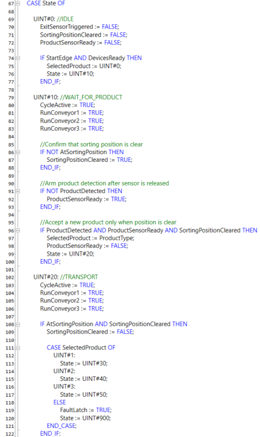
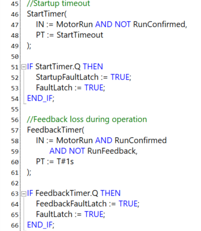
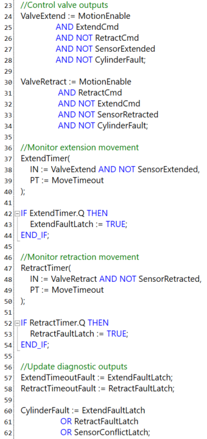
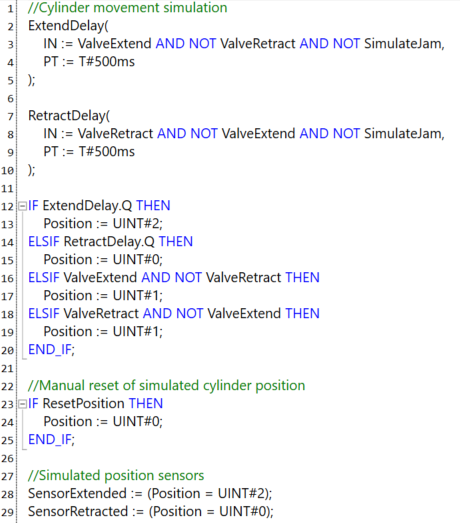
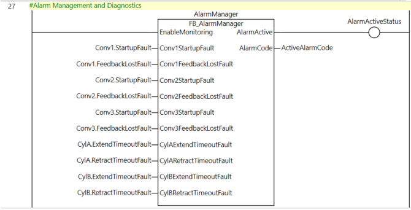
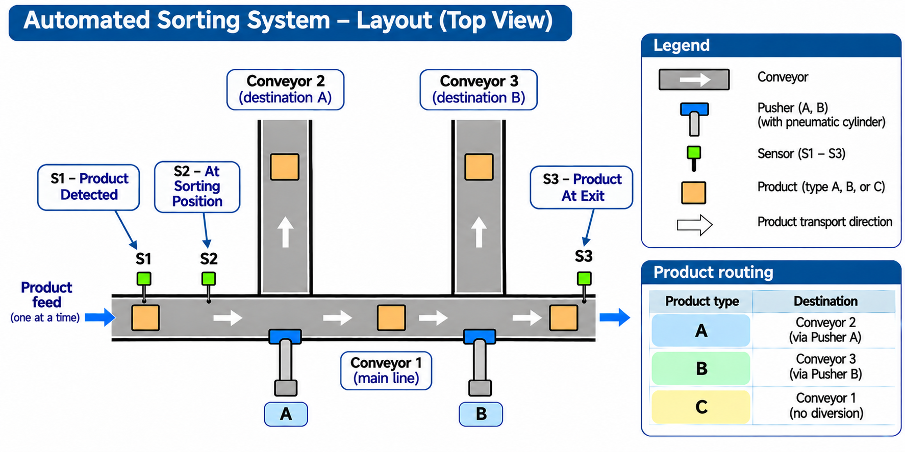

# Automated Sorting System

**PLC control and simulation project | OMRON Sysmac Studio | NJ301-1100 | Ladder Diagram + Structured Text**

[English](README.md) | [Polski](README_PL.md)

## Overview

Automated Sorting System is a portfolio project demonstrating the design, implementation and simulation of an industrial product-sorting sequence using an OMRON NJ-series PLC. The system coordinates **three conveyors and two pneumatic cylinders** to route products to one of three destinations according to their type.

The project emphasizes modular PLC programming, sequential control, equipment interlocks, fault handling, diagnostic alarm management and repeatable simulation-based testing. **It has been tested in the Sysmac Studio controller simulator, not on physical machinery.**

## System operation

The demonstration processes **one product at a time**. A product is detected at the infeed, its type is recorded, and the sequence waits for the sorting-position sensor.

| Product type | Routing action | Destination |
| --- | --- | --- |
| **1 - A** | Cylinder A extends to divert the product, then retracts | Conveyor 2 |
| **2 - B** | Cylinder B extends to divert the product, then retracts | Conveyor 3 |
| **3 - C** | Product continues without a pneumatic diversion; completion requires detection and clearance at the exit sensor | Conveyor 1 exit |

In the waiting and transport states, all three conveyors are requested to run. During a diversion, the corresponding destination conveyor remains requested; product C continues on Conveyor 1. The next cycle is armed only after the relevant sensor conditions are cleared.

## Technology and environment

- **Engineering software:** OMRON Sysmac Studio 1.64
- **Simulated controller:** OMRON NJ301-1100
- **PLC languages:** Ladder Diagram (LD) and Structured Text (ST)
- **Execution:** `PRG_SortingSystem` assigned to `PrimaryTask`
- **Hardware:** no physical PLC, drives, valves, or sensors required for the demonstrated tests
- **Project file:** native Sysmac Studio `.smc2` format

## Software architecture

The main LD program `PRG_SortingSystem` connects operator and sensor signals, computes readiness and common fault conditions, calls the sequence and equipment function blocks, and provides simulation feedback.

| Component | Language | Responsibility |
| --- | --- | --- |
| `PRG_SortingSystem` | LD | Integration, interlocks, block calls, and simulated signal wiring |
| `FB_SortingSequence` | ST | Product routing, state machine, START/STOP/RESET, cycle and system status |
| `FB_ConveyorMotor` | ST | Motor commands, feedback monitoring, startup and feedback-loss diagnostics |
| `FB_PneumaticCylinder` | ST | Valve commands, position feedback, extension/retraction timeout diagnostics |
| `FB_CylinderSimulator` | ST | Simulated cylinder position, 500 ms movement delays, jam injection, manual position reset |
| `FB_AlarmManager` | ST | Fault prioritization, active alarm indication, and diagnostic alarm codes |
| `ST_MotorSimulation` | Data type | Conveyor simulation and diagnostic signals |
| `ST_CylinderSimulation` | Data type | Cylinder simulation and diagnostic signals |

Three instances of the motor block manage conveyors 1–3. Two instances each of the pneumatic control and cylinder simulation blocks manage cylinders A and B.

## Sorting sequence (state machine)

| State | Description |
| --- | --- |
| `0` | IDLE - waits for a valid START and device readiness |
| `10` | WAIT_FOR_PRODUCT - conveyors run; product detection is rearmed after sensor release |
| `20` | TRANSPORT - waits for arrival at the sorting position |
| `30` / `31` | EXTEND_A / RETRACT_A - divert type A and return cylinder A |
| `40` / `41` | EXTEND_B / RETRACT_B - divert type B and return cylinder B |
| `50` / `51` / `52` | SORT_C / WAIT_EXIT_DETECTION / WAIT_EXIT_CLEAR - track type C through the exit |
| `60` | COMPLETE - emits a cycle-complete indication and returns to waiting |
| `900` | FAULT - latched fault state; motion commands inhibited |

The logic detects a rising edge of START, inhibits START while STOP, RESET, manual mode, disabled execution, or a fault is active, and resets commanded outputs each scan before applying state-specific actions.
Sensor rearming helps prevent a continuously active product sensor from triggering repeated cycles.
Disabling automatic mode interrupts the sorting sequence and inhibits motion commands. A latched fault remains active until the relevant reset conditions are satisfied. Re-enabling automatic mode does not automatically restart the sequence; a new START command is required.

## Fault handling and diagnostics

- **Common fault:** `AnyDeviceFault` combines faults from all three motors and both cylinders.
- **Readiness:** `DevicesReady` requires no device fault, both cylinders retracted, and no STOP command.
- **Motor diagnostics:** startup timeout and loss of running feedback are implemented in `FB_ConveyorMotor`; an external fault input is also available.
- **Pneumatic diagnostics:** `FB_PneumaticCylinder` monitors extension and retraction completion with a **2-second movement timeout** and detects conflicting position feedback.
- **Fault response:** an active fault drives the sequence to state `900`, inhibits motion requests, and prevents START from restarting the process.
- **Reset behavior:** the sequence can return to IDLE after the relevant fault conditions clear and RESET is applied; **RESET alone does not restart the system**. Individual device blocks may impose additional reset conditions.
- **Simulation controls:** `SimulateCylinderAJam` / `SimulateCylinderBJam` inhibit simulated movement completion; `ResetCylinderAPosition` / `ResetCylinderBPosition` restore simulated positions independently of alarm reset.

### Alarm management

The `FB_AlarmManager` function block monitors ten diagnostic fault signals from the conveyor motors and pneumatic cylinders.

It provides two outputs:

- `AlarmActiveStatus` - indicates whether a monitored diagnostic fault is active.
- `ActiveAlarmCode` - identifies the highest-priority active diagnostic fault.

The alarm manager uses a fixed priority order. If multiple monitored faults are active simultaneously, the first matching fault in the priority list determines the displayed alarm code.

| Alarm code | Diagnostic condition |
| --- | --- |
| `101` | Conveyor 1 - startup timeout |
| `102` | Conveyor 1 - running feedback lost |
| `201` | Conveyor 2 - startup timeout |
| `202` | Conveyor 2 - running feedback lost |
| `301` | Conveyor 3 - startup timeout |
| `302` | Conveyor 3 - running feedback lost |
| `401` | Cylinder A - extension timeout |
| `402` | Cylinder A - retraction timeout |
| `501` | Cylinder B - extension timeout |
| `502` | Cylinder B - retraction timeout |

When no monitored diagnostic fault is active, `AlarmActiveStatus` is `FALSE` and `ActiveAlarmCode` is `0`.

The alarm manager does not maintain a separate alarm latch. Fault retention and reset behavior are handled by the underlying equipment function blocks and the sorting sequence logic.

**Diagnostic scope:** The alarm-code table covers the ten monitored timeout and feedback-loss signals. Other faults, such as external motor faults or conflicting cylinder-position feedback, can contribute to the common system fault without necessarily producing a nonzero `ActiveAlarmCode`.

**Important:** This is application-level control and fault handling, **not a validated or safety-rated emergency-stop function**. A real installation would require an appropriate safety architecture, risk assessment, hardware integration, and commissioning.

## Simulation and verification

The following scenarios were exercised in Sysmac Studio:

| Test scenario | Result |
| --- | --- |
| Normal routing of products A, B, and C | Passed |
| STOP while waiting and during transport | Passed |
| START inhibited while STOP is active | Passed |
| Conveyor fault propagation and latched fault state | Passed |
| START inhibited during an active device fault | Passed |
| RESET returns to IDLE without automatic restart | Passed |
| Cylinder A extension and retraction timeouts | Passed |
| Cylinder B extension and retraction timeouts | Passed |
| Manual restoration of simulated cylinder positions | Passed |
| START/STOP regression after code cleanup | Passed |
| Alarm manager - no active fault (`AlarmCode = 0`) | Passed |
| Alarm `401` - Cylinder A extension timeout | Passed |
| Alarm `502` - Cylinder B retraction timeout | Passed |
| Alarm clearing after fault removal and reset | Passed |
| Automatic mode disabled during transport | Passed |
| Automatic mode disabled while a fault is latched | Passed |
| Restart requires a new START command | Passed |
| Normal A/B/C sorting regression after alarm integration | Passed |

These results reflect **manual simulation tests**, not a formal automated test suite or hardware acceptance testing.

## How to open and run

1. Install a compatible version of **OMRON Sysmac Studio** (the project was developed with version **1.64**).
2. Open the native `.smc2` project file from the `project/` directory using Sysmac Studio.
3. Verify that the configured controller is **NJ301-1100** and that `PRG_SortingSystem` is assigned to `PrimaryTask`.
4. Build the controller project and start the Sysmac Studio controller simulation.
5. Use the Watch Tab to set the SortingSim inputs and monitor SortingState, AnyDeviceFault, AlarmActiveStatus, ActiveAlarmCode, conveyor status, and cylinder status.
6. For a normal cycle, ensure AUTO is enabled, STOP and RESET are inactive, and devices are ready. Pulse START, set `ProductType` to `1`, `2`, or `3`, pulse `ProductDetected`, and activate `AtSortingPosition`. For type C, activate and then clear `ProductAtExit` to complete the cycle.
7. For fault tests, inject a conveyor fault or a cylinder jam and observe the diagnostic outputs and state `900`. Remove the simulated fault before resetting; use the separate simulation-only position-reset controls if necessary.
8. To verify the alarm manager, simulate a cylinder movement timeout and monitor AlarmActiveStatus and ActiveAlarmCode. For example, a Cylinder A extension timeout produces alarm 401, while a Cylinder B retraction timeout produces alarm 502.

## Screenshots

### Main PLC Program - Ladder Diagram


### Sorting Control Sequence - Structured Text


### Conveyor Motor Control and Diagnostics


### Pneumatic Cylinder Control


### Pneumatic Cylinder Simulation


### Alarm Management and Diagnostics



## System layout



## Repository structure

```text
AutomatedSortingSystem/
├── README.md
├── README_PL.md
├── docs/
│   └── sorting-system-overview.png
├── project/
│   └── AutomatedSortingSystem.smc2
└── screenshots/
    ├── 01-main-program.png
    ├── 02-state-machine.png
    ├── 03-motor-control.png
    ├── 04-cylinder-control.png
    ├── 05-cylinder-simulation.png
    └── 06-alarm-manager.png
```

## Scope and limitations

- One product is processed per cycle; simultaneous multi-product tracking is outside the current scope.
- Motor running feedback is simulated directly from the motor run output, so feedback-loss behavior is **not independently validated** by the current simulation wiring.
- Cylinder movement is represented by a simplified timer-based model, not a pneumatic or mechanical physics model.
- Transport and exit-sensor waiting states do not currently include dedicated product travel timeouts.
- The alarm manager reports one prioritized diagnostic code at a time and does not implement an alarm history or acknowledgement mechanism.
- No physical I/O, fieldbus devices, HMI, or hardware safety system is included.

## Potential future improvements

Independent motor-feedback fault injection, transport timeout diagnostics, alarm history and acknowledgement, HMI visualization, multi-product tracking, and physical PLC/I/O integration.

## Project purpose

Created as an engineering portfolio demonstration of PLC programming, structured troubleshooting, modular control design, diagnostic alarm management, and simulation-based verification in the OMRON Sysmac Studio environment.
