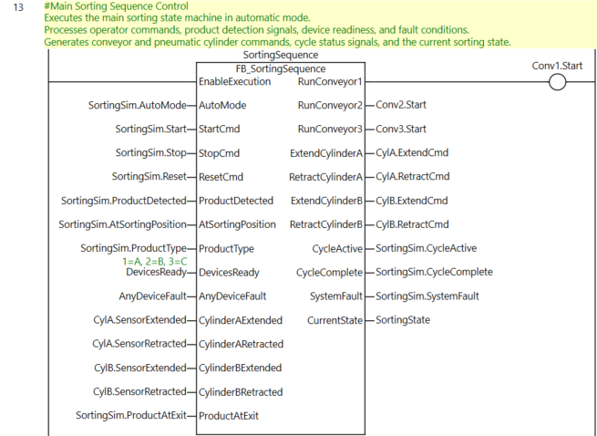
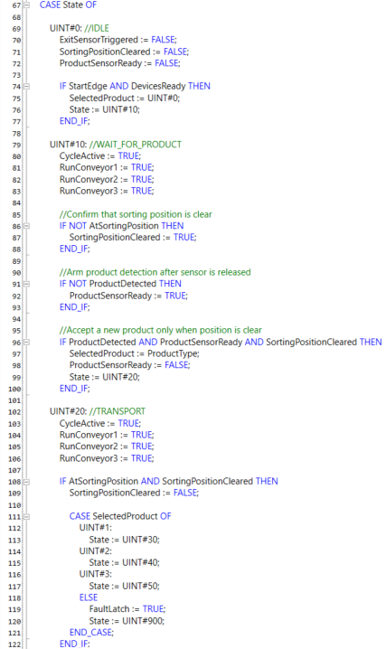
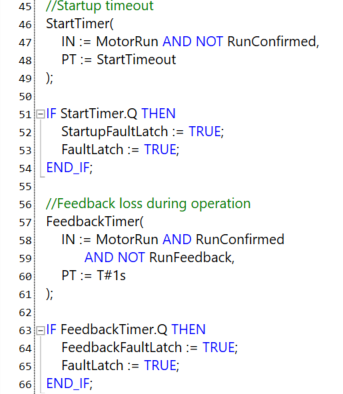
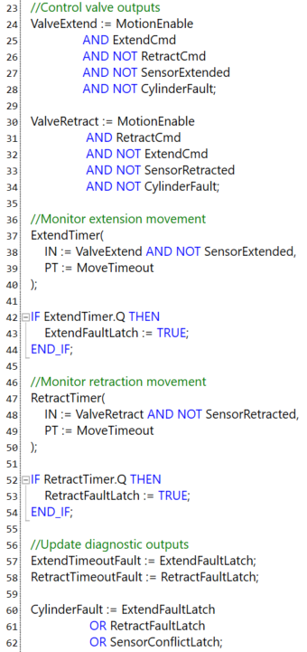
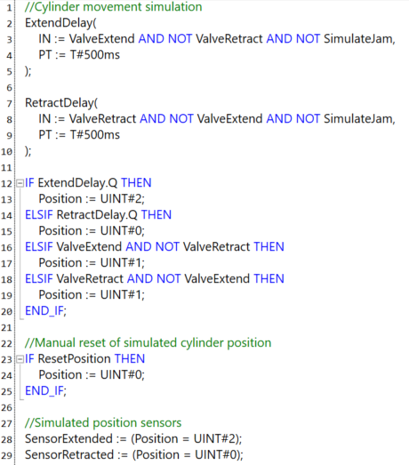
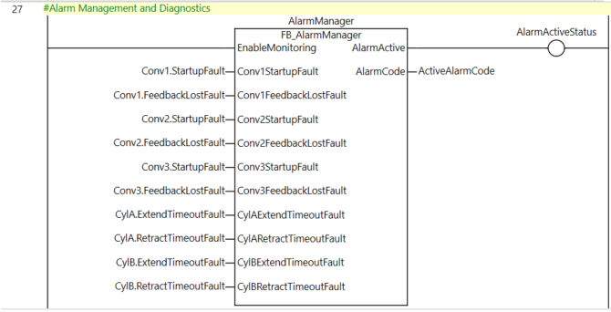

# Automated Sorting System

**Projekt sterowania PLC i symulacji | OMRON Sysmac Studio | NJ301-1100 | Ladder Diagram + Structured Text**

[English](README.md) | [Polski](README_PL.md)

## Opis projektu

Automated Sorting System to projekt portfolio przedstawiający projektowanie, implementację i symulację przemysłowej sekwencji sortowania produktów z wykorzystaniem sterownika PLC OMRON serii NJ. System koordynuje pracę **trzech przenośników i dwóch siłowników pneumatycznych**, kierując produkty do jednego z trzech miejsc docelowych w zależności od ich typu.

Projekt koncentruje się na modułowym programowaniu PLC, sterowaniu sekwencyjnym, blokadach technologicznych, obsłudze usterek, zarządzaniu alarmami diagnostycznymi oraz powtarzalnych testach w środowisku symulacyjnym. **Został przetestowany w symulatorze sterownika Sysmac Studio, a nie na rzeczywistej maszynie.**

## Zasada działania systemu

System demonstracyjny obsługuje **jeden produkt na raz**. Produkt jest wykrywany na wejściu, jego typ zostaje zapamiętany, a sekwencja oczekuje na sygnał czujnika pozycji sortowania.

| Typ produktu | Sposób sortowania | Miejsce docelowe |
| --- | --- | --- |
| **1 - A** | Siłownik A wysuwa się, kierując produkt na odpowiedni tor, a następnie cofa | Przenośnik 2 |
| **2 - B** | Siłownik B wysuwa się, kierując produkt na odpowiedni tor, a następnie cofa | Przenośnik 3 |
| **3 - C** | Produkt przemieszcza się bez przekierowania pneumatycznego; zakończenie cyklu wymaga wykrycia produktu przez czujnik wyjściowy i późniejszego zwolnienia tego czujnika | Wyjście przenośnika 1 |

W stanach oczekiwania na produkt i transportu system wysyła żądanie pracy do wszystkich trzech przenośników. Podczas przekierowania produktu pracę kontynuuje odpowiedni przenośnik docelowy, natomiast produkt C przemieszcza się przenośnikiem 1. Kolejny cykl może zostać przygotowany dopiero po spełnieniu odpowiednich warunków dotyczących sygnałów czujników.

## Technologie i środowisko

- **Oprogramowanie inżynierskie:** OMRON Sysmac Studio 1.64
- **Symulowany sterownik:** OMRON NJ301-1100
- **Języki programowania PLC:** Ladder Diagram (LD) i Structured Text (ST)
- **Wykonywanie programu:** `PRG_SortingSystem` przypisany do `PrimaryTask`
- **Sprzęt:** przedstawione testy nie wymagają fizycznego sterownika PLC, napędów, zaworów ani czujników
- **Plik projektu:** natywny format Sysmac Studio `.smc2`

## Architektura oprogramowania

Główny program LD `PRG_SortingSystem` łączy sygnały operatorskie i czujnikowe, wyznacza warunki gotowości oraz wspólne sygnały usterek, wywołuje bloki funkcyjne sekwencji i urządzeń, a także realizuje połączenia sygnałów symulacyjnych.

| Komponent | Język | Odpowiedzialność |
| --- | --- | --- |
| `PRG_SortingSystem` | LD | Integracja systemu, blokady, wywołania bloków i połączenia sygnałów symulacyjnych |
| `FB_SortingSequence` | ST | Kierowanie produktów, automat stanów, obsługa START/STOP/RESET oraz status cyklu i systemu |
| `FB_ConveyorMotor` | ST | Sterowanie silnikiem, monitorowanie sygnału potwierdzenia pracy oraz diagnostyka rozruchu i zaniku potwierdzenia |
| `FB_PneumaticCylinder` | ST | Sterowanie zaworami, monitorowanie czujników położenia oraz diagnostyka przekroczenia czasu wysuwania i wsuwania |
| `FB_CylinderSimulator` | ST | Symulacja położenia siłownika, opóźnienie ruchu 500 ms, wymuszanie zablokowania ruchu i ręczne przywracanie pozycji |
| `FB_AlarmManager` | ST | Priorytetyzacja usterek, sygnalizacja aktywnego alarmu i przypisywanie kodów diagnostycznych |
| `ST_MotorSimulation` | Typ danych | Sygnały symulacyjne i diagnostyczne przenośnika |
| `ST_CylinderSimulation` | Typ danych | Sygnały symulacyjne i diagnostyczne siłownika |

Trzy instancje bloku silnika obsługują przenośniki 1–3. Po dwie instancje bloków sterowania pneumatycznego i symulacji siłownika obsługują siłowniki A i B.

## Sekwencja sortowania (automat stanów)

| Stan | Opis |
| --- | --- |
| `0` | IDLE - oczekiwanie na poprawny sygnał START i gotowość urządzeń |
| `10` | WAIT_FOR_PRODUCT - przenośniki pracują; ponowne wykrywanie produktu jest uzbrajane po zwolnieniu czujnika |
| `20` | TRANSPORT - oczekiwanie na dotarcie produktu do pozycji sortowania |
| `30` / `31` | EXTEND_A / RETRACT_A - przekierowanie produktu A i powrót siłownika A |
| `40` / `41` | EXTEND_B / RETRACT_B - przekierowanie produktu B i powrót siłownika B |
| `50` / `51` / `52` | SORT_C / WAIT_EXIT_DETECTION / WAIT_EXIT_CLEAR - śledzenie produktu C na wyjściu |
| `60` | COMPLETE - sygnalizacja zakończenia cyklu i powrót do oczekiwania |
| `900` | FAULT - zatrzaśnięty stan usterki; komendy ruchu są blokowane |

Logika wykrywa zbocze narastające sygnału START i ignoruje go, gdy aktywne są STOP, RESET, tryb ręczny, wyłączenie wykonywania sekwencji lub usterka. W każdym cyklu programu komendy wyjściowe są najpierw zerowane, a następnie ustawiane zgodnie z bieżącym stanem automatu.

Ponowne uzbrajanie czujników zapobiega wielokrotnemu uruchamianiu cykli przez stale aktywny czujnik obecności produktu.

Wyłączenie trybu automatycznego przerywa sekwencję sortowania i blokuje komendy ruchu. Zatrzaśnięta usterka pozostaje aktywna do czasu spełnienia odpowiednich warunków resetu. Ponowne włączenie trybu automatycznego nie uruchamia samoczynnie sekwencji — wymagany jest nowy sygnał START.

## Obsługa usterek i diagnostyka

- **Usterka zbiorcza:** `AnyDeviceFault` łączy sygnały usterek wszystkich trzech silników i obu siłowników.
- **Gotowość urządzeń:** `DevicesReady` wymaga braku usterek urządzeń, wsunięcia obu siłowników oraz nieaktywnego sygnału STOP.
- **Diagnostyka silników:** `FB_ConveyorMotor` wykrywa przekroczenie czasu rozruchu i utratę potwierdzenia pracy silnika; dostępne jest również zewnętrzne wejście usterki.
- **Diagnostyka pneumatyki:** `FB_PneumaticCylinder` monitoruje zakończenie wysuwania i wsuwania z **2-sekundowym limitem czasu ruchu** oraz wykrywa sprzeczne sygnały czujników położenia.
- **Reakcja na usterkę:** aktywna usterka przełącza sekwencję do stanu `900`, blokuje żądania ruchu i uniemożliwia ponowne uruchomienie procesu sygnałem START.
- **Resetowanie:** sekwencja może powrócić do stanu IDLE po ustąpieniu odpowiednich warunków usterki i podaniu sygnału RESET; **sam RESET nie uruchamia ponownie systemu**. Poszczególne bloki urządzeń mogą wymagać spełnienia dodatkowych warunków resetu.
- **Sterowanie symulacją:** `SimulateCylinderAJam` / `SimulateCylinderBJam` uniemożliwiają zakończenie symulowanego ruchu; `ResetCylinderAPosition` / `ResetCylinderBPosition` przywracają symulowane położenia niezależnie od resetowania alarmów.

### Zarządzanie alarmami

Blok funkcyjny `FB_AlarmManager` monitoruje dziesięć diagnostycznych sygnałów usterek pochodzących z bloków silników przenośników i siłowników pneumatycznych.

Udostępnia dwa sygnały wyjściowe:

- `AlarmActiveStatus` - informuje, czy aktywna jest którakolwiek z monitorowanych usterek diagnostycznych.
- `ActiveAlarmCode` - wskazuje kod aktywnej usterki o najwyższym priorytecie.

Menedżer alarmów korzysta ze stałej kolejności priorytetów. Jeżeli jednocześnie wystąpi kilka monitorowanych usterek, wyświetlany kod odpowiada pierwszej z nich w ustalonej kolejności.

| Kod alarmu | Warunek diagnostyczny |
| --- | --- |
| `101` | Przenośnik 1 - przekroczenie czasu rozruchu |
| `102` | Przenośnik 1 - utrata potwierdzenia pracy |
| `201` | Przenośnik 2 - przekroczenie czasu rozruchu |
| `202` | Przenośnik 2 - utrata potwierdzenia pracy |
| `301` | Przenośnik 3 - przekroczenie czasu rozruchu |
| `302` | Przenośnik 3 - utrata potwierdzenia pracy |
| `401` | Siłownik A - przekroczenie czasu wysuwania |
| `402` | Siłownik A - przekroczenie czasu wsuwania |
| `501` | Siłownik B - przekroczenie czasu wysuwania |
| `502` | Siłownik B - przekroczenie czasu wsuwania |

Jeśli żadna z monitorowanych usterek diagnostycznych nie jest aktywna, `AlarmActiveStatus` ma wartość `FALSE`, a `ActiveAlarmCode` wynosi `0`.

Menedżer alarmów nie realizuje osobnego zatrzaskiwania alarmów. Za podtrzymywanie stanu usterki i warunki resetowania odpowiadają bloki funkcyjne urządzeń oraz logika sekwencji sortowania.

**Zakres diagnostyki:** tabela kodów obejmuje dziesięć monitorowanych sygnałów przekroczenia czasu i utraty potwierdzenia pracy. Inne usterki, np. zewnętrzna usterka silnika lub sprzeczne sygnały czujników położenia siłownika, mogą aktywować zbiorczy sygnał usterki systemu, nie powodując przy tym ustawienia niezerowego `ActiveAlarmCode`.

**Ważne:** jest to logika sterowania aplikacyjnego i obsługi usterek, **a nie zweryfikowana funkcja zatrzymania awaryjnego o określonym poziomie bezpieczeństwa**. Rzeczywista instalacja wymagałaby odpowiedniej architektury bezpieczeństwa, oceny ryzyka, integracji sprzętowej i uruchomienia na obiekcie.

## Symulacja i weryfikacja

W środowisku Sysmac Studio przeprowadzono następujące testy:

| Scenariusz testowy | Wynik |
| --- | --- |
| Prawidłowe sortowanie produktów A, B i C | Zaliczony |
| STOP podczas oczekiwania i transportu | Zaliczony |
| Blokada START przy aktywnym STOP | Zaliczony |
| Propagacja usterki przenośnika i zatrzaśnięty stan awarii | Zaliczony |
| Blokada START podczas aktywnej usterki urządzenia | Zaliczony |
| RESET przywraca IDLE bez automatycznego ponownego uruchomienia | Zaliczony |
| Przekroczenie czasu wysuwania i wsuwania siłownika A | Zaliczony |
| Przekroczenie czasu wysuwania i wsuwania siłownika B | Zaliczony |
| Ręczne przywracanie symulowanych położeń siłowników | Zaliczony |
| Test regresyjny START/STOP po uporządkowaniu kodu | Zaliczony |
| Menedżer alarmów - brak aktywnej usterki (`AlarmCode = 0`) | Zaliczony |
| Alarm `401` - przekroczenie czasu wysuwania siłownika A | Zaliczony |
| Alarm `502` - przekroczenie czasu wsuwania siłownika B | Zaliczony |
| Kasowanie alarmu po usunięciu usterki i wykonaniu resetu | Zaliczony |
| Wyłączenie trybu automatycznego podczas transportu | Zaliczony |
| Wyłączenie trybu automatycznego przy zatrzaśniętej usterce | Zaliczony |
| Ponowne uruchomienie wymaga nowego sygnału START | Zaliczony |
| Ponowny test prawidłowego sortowania A/B/C po integracji menedżera alarmów | Zaliczony |

Powyższe wyniki dotyczą **ręcznych testów symulacyjnych**, a nie formalnego zestawu testów automatycznych ani testów odbiorczych na rzeczywistym sprzęcie.

## Jak otworzyć i uruchomić projekt

1. Zainstaluj zgodną wersję **OMRON Sysmac Studio** (projekt opracowano w wersji **1.64**).
2. Otwórz natywny plik projektu `.smc2` z katalogu `project/` w Sysmac Studio.
3. Sprawdź, czy skonfigurowany sterownik to **NJ301-1100**, a program `PRG_SortingSystem` jest przypisany do `PrimaryTask`.
4. Skompiluj projekt sterownika i uruchom symulator sterownika w Sysmac Studio.
5. W zakładce Watch Tab ustawiaj wejścia `SortingSim` i obserwuj `SortingState`, `AnyDeviceFault`, `AlarmActiveStatus`, `ActiveAlarmCode` oraz stany przenośników i siłowników.
6. Aby wykonać normalny cykl, włącz tryb AUTO, wyłącz STOP i RESET oraz upewnij się, że urządzenia są gotowe. Wygeneruj impuls START, ustaw `ProductType` na `1`, `2` lub `3`, wygeneruj impuls `ProductDetected` i aktywuj `AtSortingPosition`. Dla produktu C aktywuj, a następnie wyłącz `ProductAtExit`, aby zakończyć cykl.
7. Aby przetestować usterki, zasymuluj awarię przenośnika lub zablokowanie siłownika i obserwuj wyjścia diagnostyczne oraz stan `900`. Przed resetowaniem usuń symulowaną przyczynę usterki; w razie potrzeby użyj osobnych, przeznaczonych wyłącznie do symulacji sygnałów przywracania pozycji siłowników.
8. Aby sprawdzić menedżer alarmów, zasymuluj przekroczenie czasu ruchu siłownika i obserwuj `AlarmActiveStatus` oraz `ActiveAlarmCode`. Przykładowo przekroczenie czasu wysuwania siłownika A generuje alarm `401`, a przekroczenie czasu wsuwania siłownika B — alarm `502`.

## Zrzuty ekranu

### Główny program PLC - Ladder Diagram


### Sekwencja sterowania sortowaniem - Structured Text


### Sterowanie silnikiem przenośnika i diagnostyka


### Sterowanie siłownikiem pneumatycznym


### Symulacja siłownika pneumatycznego


### Zarządzanie alarmami i diagnostyka


## Struktura repozytorium

```text
AutomatedSortingSystem/
├── README.md
├── README_PL.md
├── project/
│   └── AutomatedSortingSystem.smc2
└── screenshots/
    ├── 01-main-program.png
    ├── 02-state-machine.png
    ├── 03-motor-control.png
    ├── 04-cylinder-control.png
    ├── 05-cylinder-simulation.png
    └── 06-alarm-manager.png
```

## Zakres i ograniczenia

- System przetwarza jeden produkt w danym cyklu; jednoczesne śledzenie wielu produktów wykracza poza aktualny zakres projektu.
- Sygnał potwierdzenia pracy silnika jest symulowany bezpośrednio na podstawie sygnału uruchomienia silnika, dlatego zachowanie przy utracie potwierdzenia pracy **nie zostało niezależnie zweryfikowane** przy obecnym sposobie połączenia sygnałów symulacyjnych.
- Ruch siłowników odwzorowano za pomocą uproszczonego modelu czasowego, a nie modelu fizycznego pneumatyki lub mechaniki.
- Stany transportu i oczekiwania na czujnik wyjściowy nie mają obecnie osobnych limitów czasu przemieszczania produktu.
- Menedżer alarmów udostępnia jeden kod diagnostyczny o najwyższym priorytecie i nie realizuje historii alarmów ani mechanizmu ich potwierdzania.
- Nie wszystkie zaimplementowane kody alarmowe zostały przetestowane indywidualnie.
- Projekt nie obejmuje fizycznych wejść/wyjść, urządzeń magistrali przemysłowej, panelu HMI ani sprzętowego systemu bezpieczeństwa.

## Możliwe kierunki rozwoju

Niezależne wymuszanie usterek potwierdzenia pracy silników, diagnostyka przekroczenia czasu transportu, historia i potwierdzanie alarmów, wizualizacja HMI, śledzenie wielu produktów oraz integracja z fizycznym sterownikiem PLC i modułami I/O.

## Cel projektu

Projekt powstał jako demonstracja kompetencji inżynierskich w zakresie programowania PLC, systematycznej diagnostyki usterek, modułowego projektowania sterowania, zarządzania alarmami diagnostycznymi oraz weryfikacji działania w środowisku symulacyjnym OMRON Sysmac Studio.
